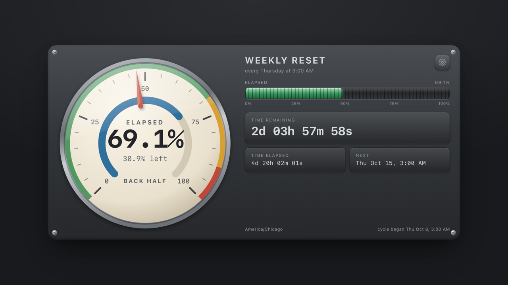
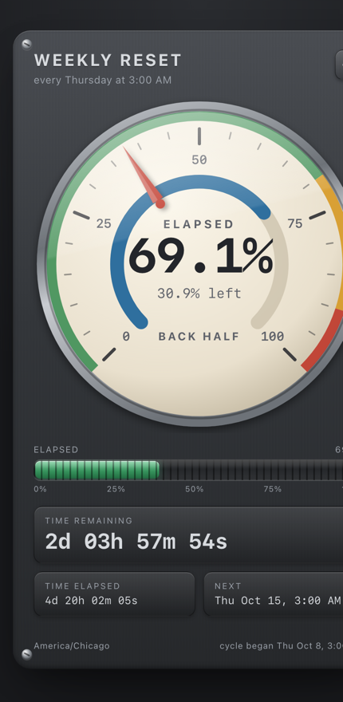

# Weekly Countdown

A dial for a recurring weekly moment — a quota or token reset, a sprint boundary,
a billing cycle, anything that comes back around on the same day each week.

**Live at [ryanarnaudin.com/sites/countdown/](https://ryanarnaudin.com/sites/countdown/)**

One HTML file, no dependencies, no build step, and no network requests at all. The
point is the proportion rather than the clock: how much of the week is gone and how
much is left, with the actual time remaining as a secondary readout.



## Use it

Open [ryanarnaudin.com/sites/countdown/](https://ryanarnaudin.com/sites/countdown/)
and leave the tab somewhere you can see it.

To run it locally instead, open `index.html` in a browser — double-click the file,
or serve the folder if you prefer a URL:

```bash
python3 -m http.server 8000
```

## What it does

- **A 270° dial** with tachometer zones: green up to 70%, amber to 90%, red past
  that. Percent elapsed sits large in the middle with percent remaining beneath it.
- **A status line** reading FRESH WEEK, ON PACE, BACK HALF, FINAL STRETCH, ANY
  MINUTE NOW, and RESETTING in the final minute. The whole panel flashes when the
  countdown rolls over to the next week.
- **A segmented bar** in a recessed trough, shifting green to amber to red at the
  same thresholds, for when the dial is more precision than you want.
- **Secondary readouts**: time remaining, time elapsed, the next occurrence, your
  timezone, and when the current cycle began.
- **Any weekday and time.** The gear opens label, day, and time. Settings persist
  in `localStorage` under the key `weekly-countdown:v1`. It defaults to Thursday at
  3:00 AM.

## Configuring by URL

A query string overrides saved settings, so a configured link is shareable and a
bookmark can point at a different deadline than the one you normally watch:

```
?day=1&time=09:00&label=Sprint%20start
```

| Parameter | Value |
|---|---|
| `day` | `0`–`6` with Sunday as `0`, or the first three letters of a weekday (`mon`, `thu`) |
| `time` | 24-hour `HH:MM` |
| `label` | The heading text, up to 40 characters |

## Notes

- **Daylight saving is handled.** The cycle runs from the previous occurrence to
  the next, computed with calendar arithmetic rather than a flat 7 × 24 hours.
  Across a DST change the week is genuinely 167 or 169 hours long while the target
  stays at the same wall-clock time, so the percentage stays honest instead of
  drifting by an hour. Checked against the November 2025 fall-back week at 169
  hours and the March 2026 spring-forward week at 167.
- **Waking from sleep.** The page renders from the local clock on a
  requestAnimationFrame loop throttled to roughly 8 fps of DOM work, and re-renders
  on `visibilitychange`, so a laptop coming back from sleep jumps straight to the
  right value rather than animating there.
- **Layout.** One column by default, two at 900px and wider with the dial on the
  left. The dial steps down on short windows so a laptop viewport never has to
  scroll.
- **Themes.** Light and dark both follow your system setting. The dial face stays
  cream in both so the numbers keep their contrast.
- **Motion and screen readers.** `prefers-reduced-motion` drops the needle and bar
  transitions. The screen-reader summary updates once a minute rather than once a
  second, so it does not chatter.



## Repo contents

| File | What it is |
|---|---|
| `index.html` | The whole application |
| `screenshots/` | Images used by this README |
| `.github/workflows/sync-to-site.yml` | Copies the page to the personal site on push |
| `.github/scripts/sync_countdown.py` | Stamps the provenance header onto that copy |

## Deploying

Pushing a change to `index.html` on `main` syncs it to the site automatically.
`.github/workflows/sync-to-site.yml` stamps a provenance header onto a copy and
commits it to the personal site repo at `sites/countdown/index.html`, which in turn
trips that repo's own build-and-deploy workflow. Jekyll passes the file through
untouched because it has no front matter, and `_data/experiments.yml` lists it on
the experiments page.

The sync compares the document body and ignores the header, so a re-run on an
unchanged page reports no change rather than manufacturing a commit whose only
difference is the date. It also refuses to run if the source ever grows front
matter, and it stops before pushing if anything other than that one file differs.

Two things it does not cover:

- The thumbnail at `images/experiments/countdown.jpg` in the site repo is a still
  of the page and only needs redoing if the design changes noticeably. Regenerate
  it and run that repo's `tools/optimize-images.sh`.
- The site already holds a byte-identical copy that was placed there by hand before
  this repo existed, so the first sync has nothing to do by its own comparison. Run
  the workflow once from the Actions tab with **force** ticked to replace that
  hand-written header; after that, ordinary pushes are enough.
